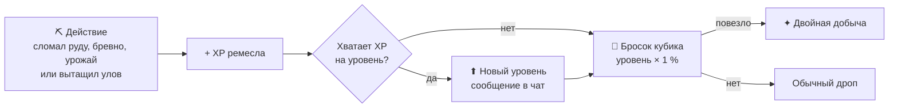

<p align="center">
  <picture>
    <source media="(prefers-color-scheme: dark)" srcset="assets/banner-dark.svg">
    <source media="(prefers-color-scheme: light)" srcset="assets/banner.svg">
    
  </picture>
</p>

<p align="center">
  <b>Профессии с уровнями для Spigot-сервера.</b><br>
  Копаешь, рубишь, ловишь, сажаешь — растёшь в ремесле и всё чаще получаешь <b>двойную добычу</b>.
</p>

<p align="center">
  <a href="https://github.com/cryandprixlop/RaskolProfessions/actions/workflows/build.yml"></a>
  
  
  
  
  
</p>

<p align="center">
  <a href="#ремёсла">Ремёсла</a> ·
  <a href="#как-это-работает">Как это работает</a> ·
  <a href="#прокачка">Прокачка</a> ·
  <a href="#установка">Установка</a> ·
  <a href="#команды">Команды</a> ·
  <a href="#настройка">Настройка</a> ·
  <a href="#планы">Планы</a>
</p>

<p align="center"></p>

## Ремёсла

Каждое ремесло прокачивается само по себе: свой уровень, свой опыт, свой шанс удвоить добычу.

<table>
  <tr>
    <th></th>
    <th align="left">Ремесло</th>
    <th align="left">Что делаем</th>
    <th align="center">XP</th>
    <th align="left">Что удваивается</th>
  </tr>
  <tr>
    <td align="center"></td>
    <td><b>Рыбак</b><br><code>FISHING</code></td>
    <td>Вытаскиваем улов</td>
    <td align="center">2</td>
    <td>Лишний предмет из улова — сразу в инвентарь</td>
  </tr>
  <tr>
    <td align="center"></td>
    <td><b>Фермер</b><br><code>FARMING</code></td>
    <td>Ломаем пшеницу, морковь, картофель, свёклу, адский нарост, какао, арбуз, тыкву, тростник, кактус, бамбук, ягодный куст</td>
    <td align="center">2</td>
    <td>Дроп блока</td>
  </tr>
  <tr>
    <td align="center"></td>
    <td><b>Дровосек</b><br><code>LUMBER</code></td>
    <td>Рубим брёвна всех 8 видов деревьев</td>
    <td align="center">1</td>
    <td>Дроп блока</td>
  </tr>
  <tr>
    <td align="center"></td>
    <td><b>Шахтёр</b><br><code>MINING</code></td>
    <td>Добываем уголь, железо, медь, золото, редстоун, лазурит, алмазы, изумруды, незер-золото и кварц (и глубинные варианты)</td>
    <td align="center">2</td>
    <td>Дроп блока</td>
  </tr>
  <tr>
    <td align="center"></td>
    <td><b>Кузнец</b></td>
    <td colspan="3"><i>скоро — стучим по наковальне</i></td>
  </tr>
  <tr>
    <td align="center"></td>
    <td><b>Зачарователь</b></td>
    <td colspan="3"><i>скоро — книги, руны и свечение</i></td>
  </tr>
</table>

> [!TIP]
> Цвета флажков в гирлянде на баннере — это цвета ремёсел в чате: рыбак — голубой, фермер — зелёный, дровосек — жёлтый, шахтёр — синий. Кузнец и зачарователь получили свои цвета заранее.

## Как это работает



Шанс удвоения равен **уровню ремесла × `double-chance-per-level`** процентов. На первом уровне это 1 %, на десятом — 10 %.
Опыт начисляется до броска, поэтому свежий уровень сразу работает на тебя.

## Прокачка

Опыт на следующий уровень растёт геометрически: `xp-base × xp-multiplier^(уровень − 1)`. С настройками по умолчанию это 8, 16, 32, 64…

<details>
<summary><b>Таблица уровней (по умолчанию)</b></summary>
<br>

| Уровень | Шанс удвоения | XP до следующего | Действий (по 2 XP) | Брёвен (по 1 XP) |
|:-:|:-:|--:|--:|--:|
| 1 | 1 % | 8 | 4 | 8 |
| 2 | 2 % | 16 | 8 | 16 |
| 3 | 3 % | 32 | 16 | 32 |
| 4 | 4 % | 64 | 32 | 64 |
| 5 | 5 % | 128 | 64 | 128 |
| 6 | 6 % | 256 | 128 | 256 |
| 7 | 7 % | 512 | 256 | 512 |
| 8 | 8 % | 1024 | 512 | 1024 |
| 9 | 9 % | 2048 | 1024 | 2048 |
| **10** | **10 %** | **MAX** | — | — |

Весь путь от 1 до 10 уровня — **4088 XP**: это 2044 действия для рыбака, фермера и шахтёра и 4088 брёвен для дровосека.

</details>

На максимальном уровне опыт больше не копится, а шанс удвоения остаётся на пике.

## Установка

**Что нужно:** сервер Spigot или Paper **1.21+** и **Java 21**.

**Готовый jar.** Каждый пуш в `main` собирается в [GitHub Actions](https://github.com/cryandprixlop/RaskolProfessions/actions/workflows/build.yml). Открой последний успешный запуск и скачай артефакт `RaskolProfessions-jar`.

**Или собери сам:**

```bash
git clone https://github.com/cryandprixlop/RaskolProfessions.git
cd RaskolProfessions
mvn clean package
```

Готовый файл лежит в `target/RaskolProfessions-1.0.0.jar`. Положи его в `plugins/` и перезапусти сервер. Конфиг появится в `plugins/RaskolProfessions/config.yml`.

## Команды

| Команда | Что делает | Права |
|---|---|---|
| `/prof help` | Список команд | все |
| `/prof info [игрок]` | Уровни, прогресс и шанс удвоения по всем ремёслам | все |
| `/prof list` | Список ремёсел | все |
| `/prof xp <игрок> <ремесло> <кол-во>` | Начислить опыт | `prof.admin` |
| `/prof set <игрок> <ремесло> <уровень>` | Выставить уровень (опыт обнуляется) | `prof.admin` |
| `/prof reload` | Перечитать `config.yml` | `prof.admin` |

Ремёсла в командах: `FISHING`, `FARMING`, `LUMBER`, `MINING` (есть автодополнение по Tab). Для команд с игроком он должен быть на сервере. Право `prof.admin` по умолчанию у операторов.

Так выглядит `/prof info`:

```text
=== Профессии Steve ===
Рыбак ур. 3 12/32 XP удвоение: 3%
Фермер ур. 1 0/8 XP удвоение: 1%
Дровосек ур. 10 MAX удвоение: 10%
Шахтёр ур. 5 40/128 XP удвоение: 5%
```

## Настройка

```yaml
# plugins/RaskolProfessions/config.yml
max-level: 10                  # потолок уровня
xp-base: 8                     # опыта за переход 1 -> 2
xp-multiplier: 2               # прогрессия: 8, 16, 32, 64...
double-chance-per-level: 1.0   # +N % к шансу удвоения за уровень

xp:                            # опыт за одно действие
  fishing: 2
  farming: 2
  lumber: 1
  mining: 2
```

<details>
<summary><b>Свои списки блоков</b></summary>
<br>

Плагин сам знает, какие блоки считать брёвнами, рудами и урожаем. Любой из списков можно заменить в `config.yml`: укажи названия материалов Bukkit заглавными буквами.

```yaml
logs:
  - OAK_LOG
  - SPRUCE_LOG
ores:
  - COAL_ORE
  - DIAMOND_ORE
crops:
  - WHEAT
  - CARROTS
```

Если ключ не задан или список пуст, действуют стандартные значения. После правок выполни `/prof reload`.

</details>

> [!NOTE]
> Прогресс хранится в `plugins/RaskolProfessions/professions.yml`. Файл сохраняется раз в 5 минут и при выключении сервера.

## Совместимость

В `plugin.yml` указаны мягкие зависимости `RaskolFishing`, `RaskolFarming`, `RaskolLumber` и `RaskolMining`. Без них RaskolProfessions работает сам по себе.

- Если установлен **RaskolFishing**, опыт и удвоение рыбака начисляются только игрокам с действующей лицензией.
- События, отменённые другими плагинами (защита территорий и прочее), опыта за блоки не дают.

## Планы

- [x] Рыбак, фермер, дровосек, шахтёр
- [x] Уровни, геометрическая прогрессия опыта, шанс удвоения
- [x] Автосохранение и сборка в GitHub Actions
- [ ] Кузнец
- [ ] Зачарователь

<p align="center"></p>

<p align="center">
  Сделано для сервера <b>Raskol</b> · автор плагина <b>Baltimor</b><br>
  <sub>Баннер и иконки нарисованы кодом: исходники в <a href="tools/banner-generator"><code>tools/banner-generator</code></a>.</sub>
</p>
